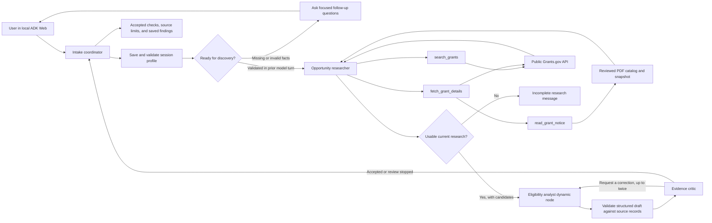

# Learning, observations, and challenges

Project: Federal Grant Opportunity Navigator  
Started: November 10, 2026  
Current stage: four-agent workflow with critic review and up to two eligibility revisions

This is a living record for the final submission and presentation. It records
observed behavior, changes, evidence, and remaining questions. Entries describe
what has actually happened; proposed features and experiments are labeled as
planned. Update the log after each implementation milestone.

## 1. Context and what we have built

A nonprofit needs to find federal grants that fit its project and applicant
profile. Our intended final application will produce a small, evidence-backed
shortlist and identify eligibility questions that remain unresolved.

The current prototype lets a user describe a project in ADK Web. An intake
coordinator saves a typed nonprofit profile and checks discovery readiness.
Once the required facts are present, it calls an opportunity researcher, which
reads that profile and uses the public Grants.gov tools. It now also reads
reviewed full-notice PDF snapshots for selected source passages. The coordinator
then runs a structured eligibility analyst against the actual saved profile and
source records. Python validates the draft and the critic examines how it uses
the evidence. The coordinator presents the reviewed eligibility checks and the
researcher's discovery notes alongside a ranked shortlist.

The current agents have distinct names in the trace: `grant_navigator`,
`opportunity_researcher`, `eligibility_analyst`, and `evidence_critic`. Repeated model calls under
one name are turns of that agent. The tools are Python functions, not additional
agents. Both review agents run dynamically. ADK Web shows their execution in
Traces. The initial static diagram shows the first two agents. The November 10 output example below comes from the
earlier single-agent version.

Implemented components:

| Component | Current behavior | Evidence |
|---|---|---|
| Environment | Python 3.12, ADK 2.14.0, pinned dependencies and lockfile | [pyproject.toml](../pyproject.toml), [uv.lock](../uv.lock) |
| Agents | Intake coordinator, researcher, eligibility analyst, and evidence critic | [agent.py](../grant_navigator/agent.py), [eligibility_workflow.py](../grant_navigator/eligibility_workflow.py) |
| Profile contract | Two facts required for discovery; optional matching/registration/mechanism facts stay unknown unless supplied; no actual UEI collected | [profile.py](../grant_navigator/profile.py) |
| Intake and handoff | Session-scoped updates, validation errors, readiness checks, and guards against mixed save/research batches | [intake.py](../grant_navigator/tools/intake.py) |
| Research result handling | Leaf researcher returns to the coordinator; absent or recognized error output produces a fixed incomplete-research message, with stale summaries cleared | [research.py](../grant_navigator/research.py), [agent.py](../grant_navigator/agent.py) |
| Search tool | Calls `search2` for posted opportunities; returns IDs, titles, agencies, status, and dates | [grants_gov.py](../grant_navigator/tools/grants_gov.py) |
| Detail tool | Calls `fetchOpportunity`; returns synopsis, applicant categories, funding fields, and document metadata | [grants_gov.py](../grant_navigator/tools/grants_gov.py) |
| Notice tool | Reads a checksum-verified, dated PDF and returns selected passages with physical page numbers and source links; unknown or unreadable sources remain unresolved | [notices.py](../grant_navigator/tools/notices.py), [catalog](../data/notices/catalog.json) |
| Evidence workflow | Records actual detail/notice results for the current invocation and profile; enforces a notice attempt before accepting a research draft | [notice_evidence.py](../grant_navigator/notice_evidence.py) |
| Eligibility contracts | Typed API records and analyst input/draft/report; eight checks, source-resolved citations, conservative scope and missing-fact guards | [opportunities.py](../grant_navigator/opportunities.py), [eligibility.py](../grant_navigator/eligibility.py) |
| Analyst result handling | Separate raw draft, accepted report, and outcome; current invocation/profile required; failed results cannot reuse an older report | [eligibility_workflow.py](../grant_navigator/eligibility_workflow.py), [research.py](../grant_navigator/research.py) |
| Model transport | 20-second HTTP timeout per attempt, at most three HTTP attempts per generation request; buffered responses and one additional request for empty terminal `STOP` | [model_client.py](../grant_navigator/model_client.py), [agent.py](../grant_navigator/agent.py) |
| Local launcher | Applies and prints the project's model selection before starting ADK Web | [run_web.py](../scripts/run_web.py) |
| Source evidence | Dated AmeriCorps API snapshot, source URLs, PDF checksum, and full 28-page notice | [API fixture](../data/fixtures/americorps_363696.json), [notice](../data/notices/FY27_ASNCompetitiveNotice_Final.508.pdf) |
| Development scripts | Refresh the example API snapshot and inspect PDF text extraction | [snapshot script](../scripts/snapshot_example.py), [notice inspection](../scripts/inspect_notice.py) |
| Tests | Tool contracts, model failure recovery, profile validation, and handoff behavior | [tests](../tests/) |
| Frozen benchmark | Seventeen developer-curated constructed-draft cases exercise the validation boundary without calling Gemini | [evaluation scope](evaluation.md), [cases](../evaluation/analyst_cases.json) |

The PDF inspection script extracted approximately 68,000 characters from 28
pages. The PDF is now available through `read_grant_notice`, initially for the
one reviewed AmeriCorps source. Grants.gov requests have a 15-second timeout and
raise application errors; API retry and saved-API-data fallback have not yet
been added. The separate PDF reader uses its reviewed snapshot and can retrieve
the same hash-verified source when the local copy is missing.

## 2. Dated learning entries

### November 13 — Define “strongest” before writing the score

We wrote down the expected order for a tutoring nonprofit comparing three
fictional grants. A project can fit a grant's topic and still ask for more than
the program can award. We put documented conflicts after other candidates with
purpose evidence. Missing facts remain visible so a user can decide what to
check next. Matching a quote to the source prevents using another grant's
evidence, but interpreting the quote still requires judgment.
[Comparison, scores and reproducible check](../examples/08-ranked-shortlist.md)

### November 13 — A correct eligibility finding can sit beside incorrect discovery notes

In the 19.05-second ADK Web run for opportunity 363696, the nonprofit identified
itself as a new AmeriCorps applicant seeking a full-cost fixed-amount grant.
The final assessment correctly scoped the conflict to the selected option. On
all three passes, the critic model recommended approval and the automated
evidence check flagged cost sharing. After two revisions, the report left
cost sharing unresolved. The final message now identifies the check and says
who raised the outstanding issue.

The researcher's notes also displayed a contact as the awarding agency and
midnight as the cutoff. The live detail response put the contact in the synopsis
agency field and AmeriCorps in the agency record. It included midnight in the
general response date. Page 1 of the saved notice identifies AmeriCorps and gives
a federal cutoff of 5 p.m. Eastern on January 13, 2027. It also says state
commissions can set earlier deadlines.
[Funding notice, p. 1](https://www.oregon.gov/oregonserves/americorps/Documents/2026-27%20Competitive%20Grant%20Documents/FY27_ASNCompetitiveNotice_Final.508.pdf#page=1)

We now give the researcher the agency and calendar date from the opportunity
record and retain the original timestamp in session evidence. Our evaluation
should check the agency, date, and next action a nonprofit sees alongside the
analyst's eligibility finding. This run supplied examples of errors that a
score for the eligibility finding alone would miss.

### November 13 — The critic can accept an assessment that contains open questions

The critic checks whether each finding follows from the nonprofit's stated facts
and the supplied notice. A missing service area can justify an unresolved route.
That assessment is ready to show the nonprofit even though the nonprofit still
has a question to answer.

In a controlled ADK run, the profile stated active SAM registration and the
analyst left that check unresolved. The critic identified a passage on page 8.
The next analyst response cited it and marked the check as met. The workflow
applied only the requested change and preserved the other checks.
[Recorded review and correction](../examples/07-critic-review.md)

An early live run produced an approval with an empty list of reviewed grants.
The application rejected it and displayed a provisional result. We added
the candidate IDs and required rule names to the review assignment and required
a nonempty review list in the generation schema. In the demo, inspect
`critic_outcome` to see whether the review completed. A trace span establishes
that the model ran.

The corrected live request completed in 23.50 seconds. The critic model initially
proposed approval. The source validator flagged two references and requested a
revision. The analyst supplied accepted citations for cost sharing and the
applicable deadline while keeping both requirements unresolved. The second
review passed. This run shows a concrete difference between the model's
verdict and the decision the workflow actually used.

We keep the model's response and the application's validated feedback in the
same history entry. This lets us distinguish a correction the critic proposed
from a source or coverage problem the Python validator detected. If an analyst
returns an identical finding after a correction request, the objection carries
forward. After two revision attempts the final assessment marks outstanding
disputes as needing verification.

One regression case removed a semicolon from a citation while keeping the
same disputed conclusion. That edit initially counted as a new basis for the
finding. The workflow now compares the words of the quoted evidence for this
check and gives the critic its previous objections on the next pass. Source
validation still compares each quotation against the original notice.

### November 13 — A structured analyst draft still needs an acceptance boundary

**Goal.** Add the third agent: compare an organization's stated facts with
opportunity records and notice evidence, then explain what needs verification.
The analyst receives typed API facts and retrieved passages rather than treating
the researcher's generated summary as authoritative input.

**Change.** The analyst returns `EligibilityDraft` JSON with eight rule checks,
profile-field references, and evidence IDs/quotes. Python resolves URLs and page
numbers from the trusted input registry; the model does not supply publishable
source URLs. Unsupported IDs, quotations outside the cited excerpt, cross-grant
references, and missing profile facts downgrade the affected check. Omitted
checks appear as unresolved rather than silently disappearing.

**Domain observation.** Registration readiness and selected-option conflicts
need different scopes. A reported inactive SAM registration, missing UEI, or
matching-funds gap is not automatically a whole-notice exclusion. Page 8's
restriction on new applicants using full-cost fixed-amount grants can block
that selected mechanism when both profile facts and the exclusion quote are
present. It does not reject cost-reimbursement or other mechanisms under the
same notice. Fixed-amount matching rules must also remain distinct from the
cost-reimbursement rule. The general API date never becomes a confirmed
applicant deadline merely because it is available or already past.

**Limits.** Evidence identity and quote membership are mechanically checkable;
correct interpretation of all conditions and exceptions is a separate task.
These conservative guards cover selected rules in one curated notice, not a
complete semantic review. Source currentness and full review remain unverified,
so overall reports cannot claim confirmed eligibility. The critic is still
needed to challenge reasoning; it will not replace source or profile checks.

**What we would do differently.** Establish draft/accepted schemas and explicit
decision scope before adding more grants or a numerical ranking. Avoid making
an apparently precise fit score hide unresolved mandatory facts.

### November 13 — Dynamic orchestration needs clear ownership of raw and accepted state

**Challenge.** Adding an analyst as an automatically available coordinator tool
would let the model request it before current research evidence exists. Rewriting
its result in another coordinator model turn could alter the accepted findings.
Earlier nested-agent work also showed that a pending parent state reset can
overwrite a child's output when both own the same key.

**Change.** A before-model callback awaits ADK's supported `run_node` path after
successful research, with typed input and a dedicated trace branch. The analyst
owns initialization of `eligibility_raw` during its nested run. After the child
returns, the coordinator validates the draft and writes `eligibility_analysis`
and `eligibility_outcome`. `eligibility_input_scope` identifies the invocation
and profile version. The renderer uses only an accepted report in that scope,
then appends the saved researcher text without another generative rewrite.

**Learning.** The raw draft, an accepted report, and a completed orchestration
step are different states. Missing/invalid output must not turn into successful
analysis or reuse a previous report after a profile change. The third agent
appears in Events/Traces even though a static diagram may show only the root's
declared coordinator/researcher relationship.

**Integration findings.** ADK's Pydantic input adapter converted serialized
dates back into Python date values; its later plain-JSON message encoder failed
before the model call. The application now validates `AnalystInput` itself and
passes its JSON-mode serialization without an ADK `input_schema` adapter. This
keeps typed validation while making the node payload JSON-compatible.

A separate runner check showed that a sub-branch does not isolate conversation
history: the analyst also received earlier researcher prose despite its explicit
structured input. The analyst now sets `include_contents='none'` to request only
that explicit input. Branch identity, schema validation, and the model's actual
message context must each be checked; one does not establish the others. These
integration findings are not, by themselves, a successful live-model retest.

**What we would do differently.** Assign one writer to each nested-run state
phase from the outset and test actual node returns and event scope alongside
pure validation logic. Do not manufacture function-call history to represent
the orchestration.

### November 13 — A valid Python schema is not necessarily a valid API request

**Observed failures.** The first live analyst attempt failed in the SDK before
HTTP: Pydantic's positive-integer constraint produced `exclusiveMinimum`, which
the SDK's response-schema adapter rejected. Changing it to an inclusive
`minimum: 1` fixed that conversion. The next attempt reached Gemini but returned
HTTP 400 because this Developer API rejected `additionalProperties` in
`responseSchema`, even though the installed SDK accepted the field.

**Change.** Omitting that unsupported keyword exposed another generic HTTP 400
without a field-level explanation. We simplified the generation schema further
by removing titles, defaults, and string/array bounds while retaining its shape,
enums, and positive ID minimum. An isolated live request then accepted that
schema and returned JSON. This identifies a working configuration without
claiming which individual removed constraint caused the generic rejection.
The application still validates every returned object against the original
strict `EligibilityDraft`, including bounds and unexpected fields. A mocked
HTTP test checks the actual serialized request and response parsing; ADK Runner
tests check the resulting workflow and failure message. The earlier live
observations are retained with [the analyst example](../examples/06-eligibility-analyst.md).

**Learning.** Python schema validation, SDK serialization, remote API acceptance,
and useful model output are separate verification layers. A mocked HTTP success
cannot establish remote acceptance. Keep a small live check after dependency
or structured-output changes, then preserve both failed observations and the
successful retest rather than treating all test counts as model quality.

### November 13 — Evaluation found a rule bug before becoming a model accuracy claim

**Change.** Added a frozen, developer-curated 17-case benchmark using the saved
AmeriCorps PDF, page-based source labels, and deliberately constructed analyst
drafts. Cases include unknown facts, route conditions, registration readiness,
conditional matching, a selected-mechanism conflict, a past general date,
forged quotations, wrong-opportunity references, and unavailable notice evidence.
The [evaluation document](evaluation.md) defines metrics and remaining studies.

**Observed behavior.** Expected multi-state route behavior exposed a detector
that treated “more than one state” as single-state because it matched “one
state” inside the longer phrase. The code and regression coverage were corrected;
the expected multi-state label was not changed to fit the implementation.
The evaluator also checks deliberately regressed validation behavior so a
forged positive or false global registration exclusion must worsen its result.

A second review found that real quotations could be assigned to the wrong
geographic branch: a single-state commission rule did not establish a route
for a multi-state project. Two frozen cases now check those wrong-condition
findings. Additional regression tests reject a negated nonprofit description
as positive applicant evidence and prevent a SAM help-link quotation plus
unrelated mandatory UEI wording from establishing an active-SAM rule.

**Learning.** Source-based expected behavior can reveal a bug even when ordinary
implementation tests pass. Keep expected labels separate from the implementation's
own success flags, and inspect uncertainty alongside resolved statuses. A system
that marks everything unknown must not appear accurate merely because it avoids
wrong positive claims.

**Limits.** These drafts are developer hypotheses, not captured Gemini outputs;
the labels have not been independently reviewed by a grant expert. The benchmark
tests the acceptance boundary, not analyst-model accuracy, broad grant coverage,
or usefulness to people. Live results and test counts belong to their particular
verification milestone and should not be inferred from the presence of this
benchmark.

**Remaining work.** Broaden reviewed sources, test the actual model on held-out
organization cases, implement the critic and compare the same cases with/without
it, then run task-based user or proxy evaluation. Record latency, model requests,
and quota failures per completed task as well as rule and citation outcomes.

### November 13 — Third-agent verification and preserved examples

**Verified scope.** The completed offline suite passed **276 tests**. All
**17 frozen developer-curated validation cases** passed. Two actual local ADK
Web scenarios then ran the coordinator, researcher, and analyst with real
Grants.gov detail calls and the saved notice. The first preserved unknown
service area and registration/mechanism facts. The second saved new applicant,
selected-mechanism, SAM, and UEI readiness facts and produced a conflict scoped
to the selected grant type. No actual UEI identifier was collected.

**Observation.** In the second live draft, the matching-rule quotation did not
establish the condition for the chosen mechanism. The validator kept that check
unresolved instead of accepting the draft's proposal. A source link and a
completed analyst call are not sufficient evidence of a supported conclusion.

**Evidence and limits.** The [analyst example](../examples/06-eligibility-analyst.md)
retains both verbatim final answers, selected JSON state and draft/report pairs,
and earlier schema failures. The two task times were 17.46 and 15.07 seconds,
separated by a 65-second quota cooldown. These are individual smoke checks, not
a latency benchmark, model accuracy study, or user study. The critic, ranking,
broader sources, and held-out model/usefulness evaluation remain pending.

### November 12 — Reading a notice is different from deciding eligibility

**Goal.** Give the researcher actual full-notice evidence instead of relying
only on the Grants.gov synopsis or model memory. This is a document-evidence
increment; the application still has two agents. The eligibility analyst,
fit scoring, and critic remain planned.

**Change.** Added `read_grant_notice`, typed source/excerpt records, and a
[reviewed-source catalog](../data/notices/catalog.json). The initial entry binds
opportunity 363696 and number `AC-08-28-26` to the saved AmeriCorps notice and its
official [Oregon government mirror](https://www.oregon.gov/oregonserves/americorps/Documents/2026-27%20Competitive%20Grant%20Documents/FY27_ASNCompetitiveNotice_Final.508.pdf).
The corresponding [agency funding page](https://www.americorps.gov/funding-opportunity/fy-2027-americorps-state-national-grants)
is retained separately as provenance.

The reader verifies SHA256 before parsing, normalizes whitespace, and selects
bounded lexical excerpts. Each excerpt has a 1-based physical PDF page, a source
link with `#page=N`, and an evidence ID containing the opportunity, hash prefix,
page, and chunk index. Results identify the November 10 snapshot and whether it
came from the saved file or a verified download. They keep currentness and
eligibility explicitly unassessed. A hash establishes which bytes were read;
it does not establish that the source is the latest notice or amendment.

If the local PDF is missing, the tool can retrieve only the catalog's approved
HTTPS `.gov` URL, with timeout and size bounds, then require the same hash.
It cannot accept an arbitrary model URL or discover every agency's PDF. Unknown
opportunity IDs, changed bytes, unreadable PDFs, and empty excerpt searches
produce explicit nonfatal results. Missing evidence does not prove ineligibility
or that a rule is absent. Scanned PDFs may require OCR, which remains unimplemented.

**Source observations.** Full relevant pages were read with `pypdf`; physical
pages 1, 7, and 8 were also rendered and visually inspected. These page numbers
match the printed labels in this document, although that is not true for every PDF.

- [Page 1](https://www.oregon.gov/oregonserves/americorps/Documents/2026-27%20Competitive%20Grant%20Documents/FY27_ASNCompetitiveNotice_Final.508.pdf#page=1)
  gives the general deadline as January 13, 2027 at 5 p.m. Eastern. The saved
  API record encodes midnight. The notice's following note says commissions
  may set earlier deadlines for single-state applicants. These sources should
  be reported separately; neither establishes the particular user's deadline.
- [Page 8](https://www.oregon.gov/oregonserves/americorps/Documents/2026-27%20Competitive%20Grant%20Documents/FY27_ASNCompetitiveNotice_Final.508.pdf#page=8)
  describes the single-state application route through commissions, followed
  by National Direct routes and exceptions. A California headquarters does
  not establish a single-state project. Keep the service-area condition and
  relevant exceptions when interpreting an excerpt.
- [Page 7](https://www.oregon.gov/oregonserves/americorps/Documents/2026-27%20Competitive%20Grant%20Documents/FY27_ASNCompetitiveNotice_Final.508.pdf#page=7)
  distinguishes matching requirements for cost-reimbursement grants from
  fixed-amount grants. The API's `cost_sharing=true` should not become a blanket
  rule across grant subtypes. Page 6's comparison table loses column relationships
  in flattened text, so page 7's prose is better evidence for this distinction.

**Learning.** Page citations make a claim inspectable, but a citation alone does
not prove that the surrounding conditions were preserved. Selected excerpts are
not a complete rule checklist. Retrieval, interpretation, applicant-specific
eligibility, and currentness are separate evaluation questions. More reviewed
notices are needed before evaluating broad source coverage.

### November 12 — Source access needs workflow enforcement and state ownership

**Challenge.** A prompt can ask the researcher to read a notice, but the model
may still try to finish after fetching only the synopsis. Fetching details and
reading their notice in the same parallel batch also risks using unconfirmed
source identity.

**State design.** The researcher records successful detail responses and notice
results in `research_evidence`, keyed to the current invocation and profile
version. A notice read requires a previously accepted detail response for the
same opportunity; a successful notice's opportunity number must match it.
A notice read batched with a detail fetch is blocked. The first implementation
tried to enforce missing reads by constructing calls after a model response.
That approach was replaced following the provider-protocol failure recorded
in the November 13 entry below. The current implementation asks the provider
for genuine calls and preserves the returned model parts.

**State issue found during integration.** Initializing evidence in the parent's
before-tool callback left an empty state delta pending while the child updated
the same key. That parent delta could overwrite the child's accepted details
after the child returned. Evidence reset now belongs to the researcher's
before-agent callback, before its own tool calls. End-to-end checks verify
that evidence survives the handoff and appears in the final
source-access summary.

**Verification at the notice milestone.** The complete suite then passed **144 tests**. Source
identity, changed/malformed/unreadable PDFs, page-linked excerpts, conditional
cost-sharing context, current-attempt state, signed model calls, source-access
ordering, and explicit failures are covered. The
[full-notice example](../examples/05-full-notice-evidence.md) preserves actual
normal, targeted-notice, and unavailable-notice outputs. At that milestone,
eligibility analysis, scoring, and critic review had not been implemented.

### November 13 — Passing simulated tests did not verify signed function-call history

**Observation.** Implementation began on November 12; the first live check was
recorded on November 13. A direct download from the approved government PDF URL
returned 304,842 bytes and the same SHA256 as the reviewed snapshot. However,
the model workflow returned `400 INVALID_ARGUMENT`. Our after-model enforcement
had constructed a `read_grant_notice` call without the thought signature that
Gemini expected on its function-call history.

The preceding simulated suite had passed 140 cases. Those checks exercised
application control flow and tools, but did not reproduce the provider's signed-
history validation. A successful PDF download also did not establish that the
complete model/tool conversation was valid.

**Diagnosis.** Google's [thought-signature documentation](https://docs.cloud.google.com/gemini-enterprise-agent-platform/models/thinking/thought-signatures)
explains that the function-call part and its signature must be preserved when
continuing a Gemini 3 conversation; a missing required signature can cause a
400 response. Creating a new call after generation bypassed that protocol.

**Change.** Removed fabricated calls. The before-model `require_notice_request`
callback now sets native `ANY` mode with only `read_grant_notice` allowed while
fetched opportunities still need notice attempts. It supplies their IDs and
leaves the resulting signed model parts unchanged. Once pending attempts have
completed, `AUTO` generation resumes. Google's [function-calling mode guide](https://aistudio.google.com/docs/function-calling?generate-content=true&hl=en#function_calling_mode)
documents the provider configuration used for this constraint.

An after-model callback can label a genuine notice call with
`custom_metadata.notice_read_enforced`, but does not replace its content or
signature. If the model nevertheless finishes before attempting required reads,
the workflow emits `NOTICE_REVIEW_INCOMPLETE`. A six-round cap also stops
repeated unsuccessful enforcement. The coordinator reports incomplete research
instead of inventing findings or treating the missing result as no matches.

**Learning.** Framework-level simulation and provider-protocol validation are
different layers. Enforce the next permitted action through the model API's
supported controls, then preserve the provider's returned message structure.
Retest the actual application path before treating an offline pass as proof
that the live workflow works.

**Retest requirement.** Use a new session after restarting the corrected server.
An older failed session can retain the unsigned call in its history, so a page
refresh alone does not establish a clean retest.

**Retest result.** After the correction, the original discovery prompt completed
in 13.47 seconds and the targeted AmeriCorps question in 8.95 seconds. Genuine
notice calls appeared in the events with no signature error. The targeted
answer cited deadline, application-route, and cost-sharing passages while the
project service area remained unknown. The final coordinator output preserved
the saved findings and included the snapshot date and actual source pages.
The current corrected suite passed 144 cases. These are retrieval/protocol and
workflow checks, not a human-labeled assessment of every generated claim.

### November 13 — One user request can consume several model requests

**Observation.** The first two native-call scenarios completed, but the third
hit `429 RESOURCE_EXHAUSTED`. The response identified this project's free-tier
limit as 15 generation requests per minute and supplied a short retry delay.
Tool selection and follow-up reasoning cause one user prompt to make several
model requests, so prompt count alone understates quota use.

**Action and result.** Kept the quota failure as an observed example, let the
reported cooldown elapse, and retried only the third scenario. It completed
in 8.15 seconds. The source was explicitly `notice_unavailable`, with no
excerpts or eligibility decision, and the final answer labeled the result as
synopsis-only. An initial delegation before profile validation was blocked;
the coordinator then validated the profile and continued correctly.

This was a test-level retry after waiting. The application does not
automatically replay quota-limited workflows. The successful combined example
contains the original first two outputs and the later third retry, alongside
the preserved failed attempts.

**Learning.** Measure model calls, latency, and quota use per completed user
task. Space live demo scenarios and distinguish provider capacity, per-minute
quota, document availability, and matching quality when diagnosing failures.
The observed quota belongs to this project/model at that time, not every plan.

### November 13 — A mechanism name is not the rule that applies to it

**Observation.** Lexical retrieval could favor a table of contents or a passage
that merely names an award mechanism. A mention of “fixed amount” in a list of
applicant types does not support its matching requirement, and a high global
keyword count can crowd out the passage containing the relevant condition.

**Change.** Retrieval skips navigation-only dot-leader passages and prefers
nearby rule language when selecting cost-reimbursement and fixed-amount
evidence. Regression checks cover the default query and focused wording variants
so the supporting conditions, including exceptions, remain available. This is
still lexical selection, not a guarantee of semantic understanding or a complete
review of every notice rule.

Focused reads now accumulate source passages by evidence ID when the PDF hash
is unchanged. A later query with `no_matching_excerpts` does not erase earlier
valid passages from that same source; its read-attempt status is retained.
No match for the new query does not establish that a rule is absent. Evidence
from different hashes is not silently merged into one reviewed snapshot.

**Learning.** Evaluate retrieval against the rule a passage supports, not merely
whether it contains the query term. Preserve useful evidence across follow-up
questions, while keeping query failure and source-version changes visible.

### November 12 — Structured intake separates discovery from matching

**Goal.** Move from one tool-using agent to an intake coordinator collaborating
with a grant researcher, without implying that eligibility or ranking is
already implemented.

**Change.** Added a typed nonprofit profile and a `save_nonprofit_profile` tool.
Organization type and project purpose are the two required discovery fields.
Service area, beneficiaries, requested funding, and timing can stay unknown.
The researcher reads the profile from shared ADK session state; a new session
does not inherit another session's profile.

The original California nonprofit prompt gives an organization location, not
necessarily a project service area. Those fields are stored separately. Partial
updates retain earlier facts, explicit clearing removes a fact, and invalid
updates preserve the previous valid profile while blocking research. A prior
research summary is cleared when a profile changes or an update is rejected,
so it is not presented in State as the result of the new facts.

**Learning.** Enough information to start a broad search is different from
enough information to evaluate a match. Requiring every matching detail before
discovery would interrupt useful exploration. Leaving an optional field unknown
is preferable to the model filling it from an assumption. Typed validation
checks structure and values; it does not prove that the model faithfully
extracted the user's statements. That still needs end-to-end evaluation.

**Evidence to inspect.** [Profile contract](../grant_navigator/profile.py),
[intake rules](../grant_navigator/tools/intake.py), and the
[demo prompts](../README.md#try-the-intake-and-handoff). The November 10 timings
and saved output are historical; they do not establish performance of this
two-agent increment.

### November 12 — A handoff needs checks beyond prompt instructions

**Challenge found during review.** ADK can execute a model response containing
multiple tool calls as a batch. A prompt saying “save the profile first” does
not by itself prevent the model from requesting a profile update and research
together. An existing permission to use an older profile would create a stale
input risk if delegation started before that update.

**Change.** The coordinator's callbacks require a validated profile save in the
current invocation before research can start in a later model turn. A callback
also examines the complete model response: if it requests both profile saving
and researcher delegation, research is blocked regardless of call order. The
researcher and its Grants.gov tools apply the readiness gate too. Invalid
updates must be corrected or explicitly cleared; an empty save cannot silently
discard a rejected correction.

**Learning.** Put workflow rules in code when tool ordering matters. Prompts
describe the desired behavior; callbacks enforce specific handoff conditions.
These checks protect input preparation, not the factual quality of the grants
returned. The researcher's search/fetch limits are currently instructions,
rather than enforced runtime budgets.

**What we would do differently.** Define state ownership and tool-ordering
invariants before adding agents, then test mixed tool batches and profile
corrections alongside the normal path.

**Verification.** The offline suite passed 41 cases, including actual ADK runner
execution with scripted model choices and mocked Grants.gov responses. Tests
cover missing facts, corrections, invalid amounts, separate sessions, direct
researcher entry, and mixed tool batches in both orders. These isolate workflow
behavior from model choice quality.

**Remaining work.** Add full-notice evidence, eligibility analysis, ranking,
and critic review. The present change is a coordinator/researcher collaboration,
not the final four-agent graph or the required critic pattern.

### November 12 — Valid data types do not guarantee faithful extraction

**Observation.** The first live three-turn Web API check completed without API
errors. However, intake saved `service_area="California"` from a statement that
only identified the organization as a California nonprofit. The final response
also omitted the researcher's explicit general-deadline label. The profile was
structurally valid, so validation tests alone could not expose the assumed fact.

**Change.** Added concrete examples showing which fields to extract and omit,
set both agents' temperature to 0, and reinforced deadline wording in the final
coordinator response. Restarted the verified local development server to load
the revised instructions.

**Retest.** The same three prompts completed with no error events. Missing input
produced focused questions with no Grants.gov call (1.89 seconds). Complete
minimum intake triggered both agents, two searches, and one detail fetch
(8.04 seconds); service area, beneficiaries, funding, and timing stayed unknown.
The correction then saved Santa Clara County and seniors, retained prior facts,
cleared the old research summary, and made no new search (1.72 seconds).

Both the initial observation and the successful retest are preserved in the
[intake example](../examples/02-structured-intake-and-handoff.md). These are
individual timings through ADK Web's API, not a latency benchmark or a visual
inspection of the browser. The initial mistake is retained as evidence rather
than silently replaced by the improved result.

**Learning.** Prompt examples can improve a specific extraction case, but one
successful retest does not establish reliability. Temperature 0 is not a
guarantee of correctness. Add varied, human-labeled profile extraction cases
and verify that the coordinator preserves source caveats. This is also a useful
future responsibility for the critic and structured output validation.

### November 12 — An empty handoff is not evidence of no matches

**Observation.** A later user run made three successful Grants.gov searches and
three successful detail calls. The research agent then called
`transfer_to_agent` for the coordinator. Inside that nested branch, the
coordinator produced candidate text, saved the profile again, and received
`MODEL_RETURNED_NO_CONTENT` with an empty `STOP` response. The outer researcher
call returned `{"result": null}`. The final coordinator answer said no matching
grant opportunities had been returned, although the search tools had returned
records.

The [preserved failure](../examples/03-empty-result-handoff.md) contains selected
public demonstration input, tool calls, result summaries, error, and generated
texts. It excludes session state and private configuration. The sequence shows
an unexpected control transfer followed by an empty response; it does not
prove that the transfer caused Gemini to return empty content. Keyword results
also do not establish that any of the retrieved grants were suitable.

**Change.** Restricted the researcher to a leaf role by disabling transfers to
its parent and peers. It should return its own findings, which ADK delivers to
the coordinator automatically. Added a content-level retry of the same model
request once for a terminal empty `STOP`, before exposing the response to ADK.
The retry does not replay external tools. Error responses, safety blocks,
refusals, and other finish reasons do not enter this additional retry path.

Added a handoff check for raw `None`, blank or null-like text, and recognized
error returns. A failed handoff clears the saved summary and records a failed
research outcome. Before another model interpretation, a callback returns a
fixed explanation: research was incomplete and the run does not establish
whether matching grants are available. A new research attempt also clears old
findings, so an earlier successful result cannot masquerade as this attempt's
output.

An initial routing retest delivered nonempty researcher text, but a later
coordinator rewrite omitted the findings and displayed only unresolved
questions and an instruction-like sentence. This exposed a separate output
delivery problem even though the handoff itself had completed. The coordinator
now adds a profile summary in Python and appends the saved researcher findings,
without a final generative rewrite. Regression tests check that source links,
deadline caveats, and the full researcher text survive in the final answer.

**Retry tradeoff.** The existing three HTTP attempts apply to each generation
request. Retrying an empty response creates at most one extra generation
request, so that model turn can use up to six HTTP attempts in total. This may
add latency and token usage. If both responses are empty, the original error
path remains available; retries are not treated as proof of a completed task.

**Learning.** Validate the result passed between agents, not only the API calls
they make. A tool can succeed while the user-facing task fails. Absence of a
researcher's findings and a supported “no suitable grants found” conclusion
must remain different outcomes. The new handoff check establishes delivery of
text, not its factual accuracy; source validation and the critic remain needed.

**What we would do differently.** Explicitly define whether a specialist may
transfer control, and test a successful API sequence followed by an empty or
failed agent return before relying on the final coordinator answer.

**Verification.** The complete offline suite passed **79 tests**. These include
one-empty-response recovery, stopping after a second empty response, valid
tool-call preservation, safety/error exclusions, unavailable transfer tools,
failure after successful grant calls, deterministic failure reporting, and
unchanged delivery of saved researcher findings without a final rewrite.

The [live retest](../examples/04-handoff-recovery-retest.md) covered missing
details (15.67 seconds), research (38.89 seconds), and another search using the
saved profile (8.02 seconds). Both searches returned findings and recorded a
completed handoff; neither produced a transfer or error event. Final coordinator
answers appended the saved findings. The live test did not reproduce an empty
model response; content retry and exhausted-failure behavior were tested under
controlled conditions. Timings are individual observations, not benchmarks.

The initial routing retest that exposed the coordinator rewrite problem is
preserved alongside the final retest. Passing an internal delivery check alone
did not establish that the user received the findings; we strengthened the
checks to cover the displayed final answer.

### November 10 — Model availability is a separate dependency

**Observation.** The initial `gemini-flash-latest` call returned
`503 UNAVAILABLE` with a high-demand message. The first browser trace spent
about 6 minutes 37 seconds in model generation, before a grant tool ran. A
later diagnostic returned 504 after 45 seconds.

**Action.** We listed the models accessible to the configured key and tested
`gemini-3.5-flash-lite`. It answered a minimal prompt in 1.4 seconds. We selected
that concrete model and added explicit request timeouts and bounded retries.

**Learning.** An unavailable model can prevent an otherwise functioning tool
from being reached. The first diagnostic should isolate a small model request
from a grant API request. A 503 high-demand message does not establish that the
free-tier quota has been exhausted. Retries help brief failures; they do not
guarantee provider availability.

**What we would do differently.** Set request timeouts, choose an explicit
model, and run a minimal model check before the first live UI demonstration.

### November 10 — Test the model used by the running browser server

**Observation.** A separate backend test succeeded, but the user's browser
still returned 503. Reading the failed browser trace showed
`gen_ai.request.model = gemini-flash-latest`, even though the local `.env` file
had been changed to `gemini-3.5-flash-lite`.

**Action.** We inspected the actual server trace, restarted the confirmed local
ADK server, and added a launcher that explicitly applies the model from the
project configuration and prints it at startup. ADK can preserve an exported
shell variable over a value in `.env`; long-running processes can also retain
loaded settings. The exact source of the stale value was not proven.

**Result.** The original prompt then completed through the browser API in
13.5 seconds. Its trace confirmed `gemini-3.5-flash-lite`, two search calls, and
one detail call. A subsequent user run completed in 6.19 seconds.

**Learning.** A working SDK or backend test does not prove the active browser
server uses the same configuration. Verify the model and tool sequence in the
actual trace.

**What we would do differently.** Check the browser execution path earlier and
make the selected model visible in startup output from the beginning.

### November 10 — Streaming changes failure behavior

**Observation.** Investigation of the installed SDK found that an error can
arrive inside an HTTP-200 server-sent event stream, after the HTTP retry scope
has finished. A local mocked reproduction failed after one request even with
three attempts configured. The initial recovery tests covered non-streaming
model requests and missed this behavior.

**Action.** We added `BufferedGemini`, which uses non-streaming model generation
even when ADK Web requests streaming. ADK continues to emit tool and agent
events; the model's text appears when that model turn finishes. The recovery
tests now exercise both values of the caller's streaming option.

**Learning.** Test the transport used by the UI, including how errors arrive.
A successful HTTP connection does not guarantee a successful streamed model
response. Buffering is a practical tradeoff for this local prototype; it gives
up token-by-token text display while preserving the trace and retry behavior.

### November 10 — Public grant data is useful but not a complete eligibility decision

**Observation.** The public Grants.gov search and detail endpoints worked
without an API key. However, data exploration found blank deadlines and funding
fields represented as the text `"none"`. A posted status alone does not prove
that a grant is currently actionable for a particular user.

**Action.** The wrapper preserves unknown dates and nonnumeric funding fields
rather than inventing dates or treating unknown amounts as zero. It validates
basic tool inputs and returns a consistent subset of the API fields.

**Learning.** The application needs explicit rules for unknown information.
Status, deadlines, applicant restrictions, and geographic rules will require
separate validation before ranking. Those domain checks remain planned.

### November 10 — A full notice contains rules absent from the synopsis

**Observation.** Opportunity details may contain attachment metadata without a
direct download URL. The AmeriCorps source page could not be fetched from this
environment during exploration, so we saved the full notice from an official
Oregon government mirror and recorded its checksum.

The saved AmeriCorps notice gives a concrete reason to read the full document:
PDF page 1 says state commissions may set earlier deadlines, and page 8 describes
the application route for organizations operating in one state. The general
API response date is not necessarily the nonprofit's applicable deadline.

**Learning.** Finding a plausible grant and establishing application readiness
are different tasks. A candidate should be marked as needing verification when
the full notice or a necessary user fact is unavailable. The agent used the
API synopsis at that stage; the saved PDF was development evidence,
not evidence the agent retrieved during that November 10 successful run.

**What we would do differently.** Verify the availability of full notices and
define page-level source records before implementing eligibility scoring.

### November 10 — The model refined its query without a programmed search loop

**Observation.** In the user's successful run, the model first searched for
`volunteer community programs` with 10 rows, then searched for
`AmeriCorps community volunteer non-profit` with 5 rows, then fetched opportunity
363696. The API reported 703 and 492 total results respectively; the tool
returned only the requested 10 and 5 records.

**Learning.** The model chose the query text, result count, and candidate to
investigate. The trace proves these choices occurred. It does not prove the
second query was better, that all results were reviewed, or that the selected
grant was the strongest match. The first search was not an empty-result failure.
We still need explicit search bounds, eligibility gates, and an evaluated
ranking rubric.

See the [preserved run](../examples/01-community-volunteer-search.md) for exact
tool arguments and the generated response.

### November 10 — Prompt instructions can leak into the final answer

**Observation.** The generated response repeated a development instruction:
“This prototype only proves the data path; do not claim that a final eligibility
ranking has been completed.” This sentence was addressed to the model but
appeared in the user's answer.

The answer also included a state-commission deadline caveat. That caveat is
consistent with the saved notice, but the agent did not read that notice in this
run and did not cite a page for it.

**Learning.** A fluent, plausible answer may contain internal instructions or
unsupported claims. We need a structured result format and a user-facing
renderer. The planned critic should check claim support and specific output
quality requirements. These observations have been recorded; the output has
been preserved as generated rather than silently corrected.

### November 10 — Local platform compatibility affected setup

**Observation.** Installation selected cryptography 50.0.2, which required a
source build on this Intel Mac. That build failed because the required OpenSSL
build environment was absent.

**Action.** We used Python 3.12 and pinned cryptography 48.0.1, which had a
compatible wheel. The environment installed successfully, and `uv.lock` records
the resolved versions.

**Learning.** Reproducible setup includes platform compatibility as well as
Python package names. This compatibility pin should be reviewed when the
environment or dependencies change.

## 3. What the evidence does and does not show

The November 10 evidence demonstrates that a model can select our tools, ADK
can execute real Grants.gov calls, and the data can be returned to a user
through the local browser. At that stage, nine tests checked selected
API-response contracts and model recovery behavior. New intake and handoff
checks address workflow behavior; they are not grant relevance or eligibility
evaluation. The earlier November 12 intake increment passed 41 offline tests and has
[preserved live run evidence](../examples/02-structured-intake-and-handoff.md)
for missing input, two-agent research, and corrections. A later
[failed handoff](../examples/03-empty-result-handoff.md) is retained alongside it.
The preceding reliability changes passed 79 offline tests and have their own
[live retest evidence](../examples/04-handoff-recovery-retest.md), including
checks that the displayed final answer preserves the saved researcher findings.
The newer notice-reader increment is tracked separately; the old count does
not establish its verification or the quality of the model's notice interpretation.

The November 13 analyst stage adds structured checks and an offline 17-case
validation benchmark. Those developer-curated labels and constructed drafts
exercise evidence/decision guards; they do not measure the actual analyst
model's predictions. Citation integrity also does not establish complete
semantic correctness. See [the evaluation scope](evaluation.md) for metrics,
source/code provenance, and held-out model and user studies still to do.

The 6.19-, 7.3-, and 13.5-second runs are individual observations with different
prompts or execution paths. They are not a latency benchmark, a service-level
guarantee, or evidence that the grant matches are correct. No user study or
grant-expert-validated model domain evaluation has been completed.

## 4. Submission and presentation evidence tracker

| Requirement | Current evidence | Work still needed |
|---|---|---|
| Practical application | Defined nonprofit use case and working grant discovery prototype | Evaluate whether users can act on a shortlist |
| Multi-agent system | Four agents run in ADK with targeted revisions | Measure the effect of critic review on held-out profiles |
| Multiple decisions | Readiness/handoff/evidence gates; structured rule checks and selected-mechanism conflict guards implemented | Evaluate the actual model's decisions and add ranking |
| At least one external tool | Two live Grants.gov tools plus a reviewed-notice reader | Broaden document coverage and evaluate source/citation support |
| Critic pattern | Critic checks accepted eligibility findings and can request up to two revisions | Compare quality, calls and time with and without the critic |
| Code | Four agents, evidence validation, revision loop, launcher, tests and evaluator | Complete ranking and broader model/user evaluation |
| A few output examples | Discovery, intake, notice and analyst examples, plus a controlled before/after critic correction | Collect final ranked shortlist examples |
| Learning and challenges | This log with dated incidents and reflections | Append findings from each next milestone |
| Presentation context | Use case and current flow in README | Final architecture and scenario descriptions |
| Demo scenarios | Discovery, missing input, source limits, a selected-option conflict and a targeted critic correction | Capture final ranked and no-match scenarios |
| Evaluation | Contract/workflow tests and 17-case frozen acceptance-boundary benchmark | Broader held-out model cases, expert label review, critic comparison, ranking, and user task testing |

## 5. Presentation talking points available now

- Explain the nonprofit's problem and the intended evidence-backed shortlist.
- Run the community-volunteer prompt and open the ADK trace. Point out that the
  model chooses tool calls while Python executes the external requests.
- Show the current profile in State, then explain why discovery can proceed
  while service area or funding is unknown. Compare a missing-input prompt
  with a profile correction and inspect the coordinator/researcher handoff.
- Show how the trace exposed an unavailable or stale model before any grant
  tools ran, and how the launcher and bounded request settings improved diagnosis.
- Show the API snapshot alongside the full notice's applicant-route and deadline
  rules. Use `read_grant_notice` for the curated AmeriCorps example and inspect
  page links, the snapshot date, and the evidence record in State. Explain why
  selected passages alone are insufficient for eligibility or currentness.
- Run the targeted AmeriCorps scenario with only the initial nonprofit facts;
  show the dynamic `eligibility_analyst` trace and explain its unresolved checks.
  Then provide new-applicant/full-cost-fixed-amount and active SAM/valid UEI
  facts. Explain why the source-backed conflict concerns that selected option
  rather than rejecting the entire funding opportunity.
- Compare `eligibility_raw` with `eligibility_analysis` in State and show a frozen
  benchmark case with an unsupported draft. Explain the difference between
  mechanically valid citations, supported interpretation, and a useful user
  outcome; the implemented benchmark measures the first acceptance boundary.
- Describe the query refinement and the instruction copied into the final
  answer as observed behavior that motivates evaluation and a critic.
- Show why successful API calls alone did not guarantee a correct final
  response: compare the failed handoff's returned records, empty agent result,
  and unsupported no-match conclusion. Explain the new result guard and its
  remaining limits.

## 6. Template for future entries

### Date — Short observation or challenge

- **Goal/scenario:** What were we trying to accomplish?
- **Observed behavior:** What actually happened?
- **Evidence:** Output example, source excerpt/page, trace, or test result.
- **Diagnosis:** What is confirmed? What remains a hypothesis?
- **Change:** What did we implement or change?
- **Verification:** How did we check the result?
- **Learning:** What does this teach us about agents, tools, or users?
- **What we would do differently:** One concrete improvement to our approach.
- **Remaining work:** What should be tested or built next?

Do not record credentials or export entire private sessions into the submission.
Preserve selected prompts, responses, tool arguments, source references, and
measured observations needed to explain the result.
