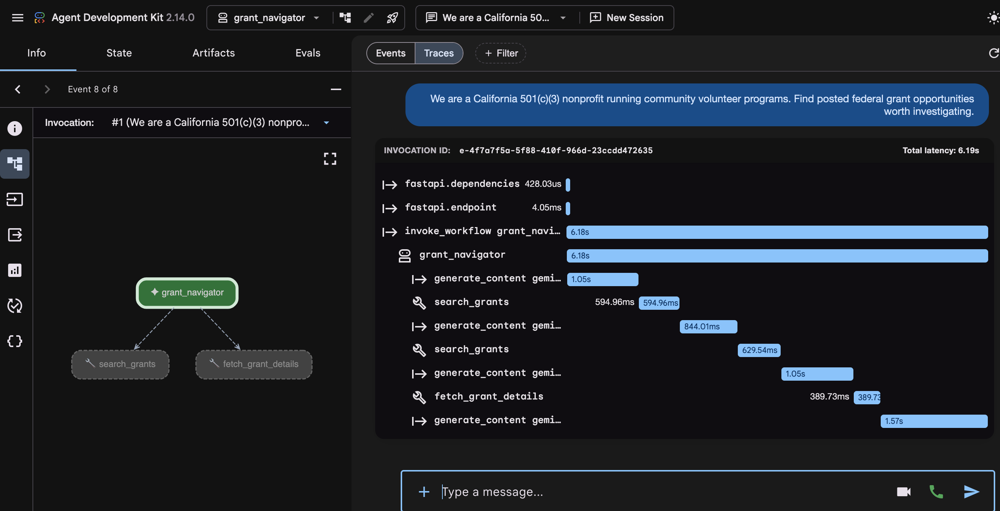

# Example 01: Community volunteer grant discovery

Status: observed prototype run, preserved as generated. This example uses one
agent and two Python tools; it predates eligibility scoring and critic review.

## Run information

- Date: November 10, 2026 at 12:44:07 PM PST.
- Interface: local ADK Web 2.14.0.
- Configured model: `gemini-3.5-flash-lite`.
- Invocation ID: `e-4f7a7f5a-5f88-410f-966d-23ccdd472635`.
- Total latency shown in the user's ADK trace: **6.19 seconds**.
- Execution: live Grants.gov calls, not a replay of the saved fixture.
- Export source: selected prompt, tool arguments/results, and final text from the
  local ADK session. Credentials and session state are excluded.

## Input

```text
We are a California 501(c)(3) nonprofit running community volunteer programs. Find posted federal grant opportunities worth investigating.
```

## Observed tool sequence

| Step | Tool | Arguments | Result summary |
|---|---|---|---|
| 1 | `search_grants` | `{"rows": 10, "keyword": "volunteer community programs"}` | 703 total results reported; 10 records returned |
| 2 | `search_grants` | `{"rows": 5, "keyword": "AmeriCorps community volunteer non-profit"}` | 492 total results reported; 5 records returned |
| 3 | `fetch_grant_details` | `{"opportunity_id": 363696}` | Fetched opportunity ID 363696 |

The first search returned results. The second query was a model-selected
refinement, not demonstrated recovery from an empty search. Search counts and
results reflect this run and may change in live data.

## Generated response — verbatim

```text
Hello! As an early-stage grant research assistant, I can help you identify federal funding opportunities that align with your nonprofit's mission.

Based on your profile as a California 501(c)(3) nonprofit operating community volunteer programs, here is a prominent candidate worth investigating:

* **Opportunity Number:** AC-08-28-26
* **Title:** Fiscal Year (FY) 2027 AmeriCorps State and National Competitive Grants
* **Agency:** AmeriCorps
* **Deadline:** January 13, 2027 *(Note: Please verify specific internal or state-level commission deadlines, as AmeriCorps often requires going through state service commissions first).*
* **Synopsis:** This program awards grants to eligible organizations (including 501(c)(3) nonprofits) to engage AmeriCorps members in evidence-based or evidence-informed interventions to strengthen communities, tackle pressing challenges, and foster civic engagement and volunteerism. 

*Disclaimer:* A synopsis is insufficient for a final eligibility decision. Full-notice verification is required, and deadlines or rules must be verified directly through the official documentation. This prototype only proves the data path; do not claim that a final eligibility ranking has been completed.

*This product uses the Grants.gov API but is not endorsed or certified by the U.S. Department of Health and Human Services.*
```

## Review notes

- The trace demonstrates real search/detail calls and a completed response.
- Only one candidate was described. No top-three ranking or numerical fit score
  was computed, and no critic agent reviewed the answer.
- The agent did not read the full notice during this run. A separate inspection
  of the saved notice found single-state applicant routing on PDF page 8 and
  earlier state-commission deadline guidance on PDF page 1. The response does
  not cite those pages or verify the nonprofit's applicable state deadline.
- The response copied an instruction addressed to the model into the user's
  answer: “do not claim that a final eligibility ranking has been completed.”
  A future output formatter and critic should address this presentation issue.
- This is a connectivity and behavior example, not a human-validated eligibility
  decision or proof that this is the strongest match.

Related evidence: [dated API snapshot](../data/fixtures/americorps_363696.json),
[saved full notice](../data/notices/FY27_ASNCompetitiveNotice_Final.508.pdf), and
[learning log](../docs/learning-log.md).

## User-provided trace screenshot


