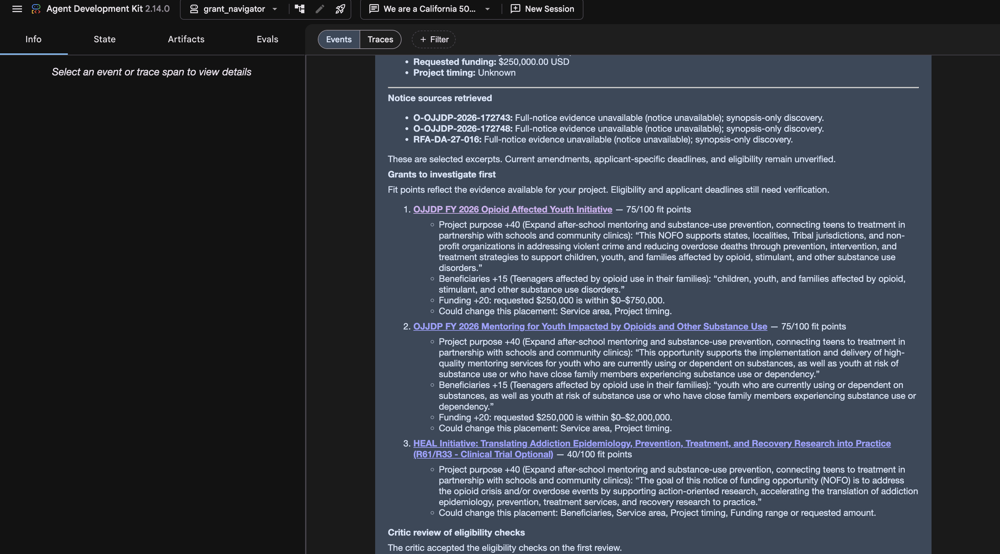
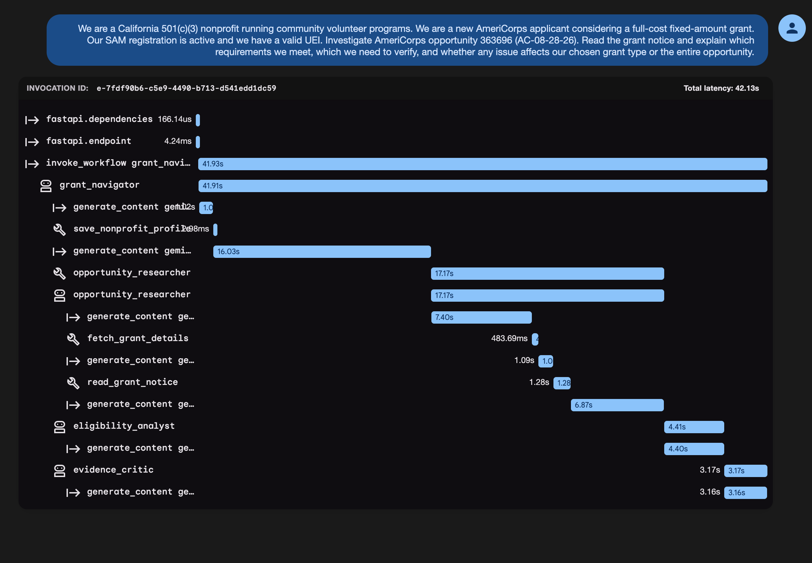

# Output examples

## Presentation demo scenarios

Run each prompt in a new ADK Web session. The prompts also appear in the
[project README](../README.md#presentation-demo-scenarios).

### Demo 1 — Live grant comparison

> We are a California 501(c)(3) nonprofit serving teenagers across the state
> who are affected by opioid use in their families. We’re seeking $250,000 to
> expand after-school mentoring and substance-use prevention. We partner with
> schools and community clinics to connect teens to treatment. The clinics
> provide clinical care; our staff provide mentoring.
>
> Fetch the details for Grants.gov opportunity IDs 364058, 364057, and 364040.
> Which should we investigate first and why? Show the fit score for each grant
> you rank. If you set one aside, explain which part of our project doesn’t fit.

The screenshot below shows a later live result with fit scores of 75, 75, and
40. The two youth-focused grants tied, while the research-focused HEAL grant
received only purpose-fit points. Its full 40 purpose points still need human
review because the nonprofit describes mentoring and clinic referrals, while
that grant centers on research. A previous development run scored a treatment
grant 60 and exposed an interpretation problem: the analyst gave it full
purpose-fit points although the nonprofit said its clinic partners provide
treatment. Neither live run has a complete output record saved in this folder.
The [ranked shortlist example](08-ranked-shortlist.md) is a separate controlled
comparison using fictional grants.

### Demo 2 — AmeriCorps eligibility and critic

> We are a California 501(c)(3) nonprofit running community volunteer programs.
> We are a new AmeriCorps applicant considering a full-cost fixed-amount grant.
> Our SAM registration is active and we have a valid UEI. Investigate AmeriCorps
> opportunity 363696 (AC-08-28-26). Read the grant notice and explain which
> requirements we meet, which we need to verify, and whether any issue affects
> our chosen grant type or the entire opportunity.

The [saved output and trace](07-critic-review.md) show the selected grant-type
conflict, notice evidence, and an analyst revision after an evidence check.
Another live run may receive critic approval on the first review.

For each new example, record the date, scenario, model configuration, input,
relevant sources, tool sequence, final output, expected behavior, and review
notes. Label simulated failures and frozen-data runs explicitly. Avoid
claiming a final eligibility decision before the supporting notice is checked.

## Additional preserved analyst scenarios

1. **Missing facts:** Use the original California 501(c)(3) community-volunteer
   profile and target AmeriCorps opportunity 363696 so the reviewed notice is
   available. Preserve the unknown service area, registration/mechanism facts,
   source-currentness limit, and follow-up questions.
2. **Selected-option conflict:** Add that the organization is a new AmeriCorps
   applicant seeking a full-cost fixed-amount grant, with active SAM and valid
   UEI readiness. With the page 8 exclusion quote, preserve a conflict scoped
   to the selected mechanism rather than a rejection of every grant type in
   the notice. Do not collect or publish the actual UEI.

The [frozen validation benchmark](../docs/evaluation.md) uses constructed drafts
and saved source text. Its JSON results belong to evaluation evidence rather
than a captured model-generated conversation or a user study.

This directory preserves selected actual runs for the final submission and
presentation. It contains the original single-agent example, a three-turn
intake/research example, an observed handoff failure and retest, and full-notice
evidence. Analyst-stage examples must retain their own configuration and
verification scope rather than inherit an earlier run's success status.
Source fixtures under `data/` are reference data, not generated output examples.

| Example | Status | Evidence |
|---|---|---|
| [Community volunteer grant discovery](01-community-volunteer-search.md) | Observed November 10, 2026; one agent with two tools | Exact prompt, tool arguments, generated response, and trace screenshot |
| [Structured intake and researcher handoff](02-structured-intake-and-handoff.md) | Observed November 12, 2026; two agents | Missing-input questions, live research, profile correction, selected JSON evidence, and an earlier extraction mistake |
| [Empty-result handoff failure](03-empty-result-handoff.md) | Observed November 12, 2026, before the latest reliability fix | Successful grant API calls, unexpected nested transfer, empty model response, `null` researcher result, and unsupported no-match answer |
| [Handoff recovery retest](04-handoff-recovery-retest.md) | Observed November 12, 2026, after the reliability fixes | Missing-input questions, two completed research requests, final-answer preservation, and an earlier rewrite omission |
| [Full-notice evidence](05-full-notice-evidence.md) | Observed November 13, 2026; three scenarios completed, the third after a quota cooldown | Reviewed PDF download, page-linked excerpts, explicit missing-source status, and preserved signature/quota observations |
| [Eligibility analyst](06-eligibility-analyst.md) | Observed November 13, 2026; two targeted live scenarios passed | Three runtime authors, raw/accepted reports, unknown facts, a fresh profile correction, a selected-option conflict, and earlier schema failures |
| No suitable match after full screening | Planned | Capture source-backed exclusions and refusal to fill the shortlist with unsupported candidates |
| Unavailable source or API failure | Planned for the final workflow | Capture recovery or a clear unresolved status |
| [Critic review and correction](07-critic-review.md) | Four-agent milestone | Recorded live behavior and a controlled ADK correction with the original finding, source passage, targeted revision and recheck |
| [Ranked shortlist](08-ranked-shortlist.md) | Controlled comparison and a live analyst check on three fictional descriptions | Expected order, fit scores, and extraction observations |

Learning and challenges are maintained in [the learning log](../docs/learning-log.md).
